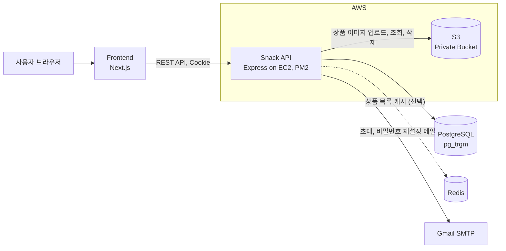
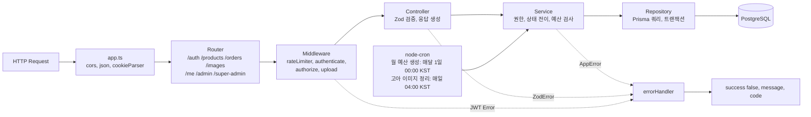
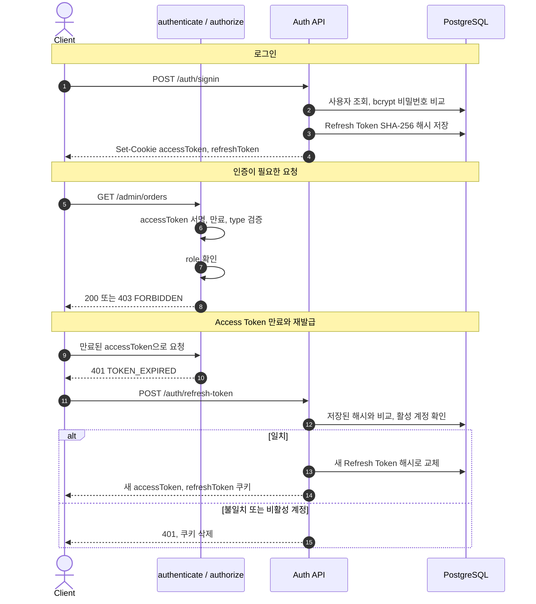
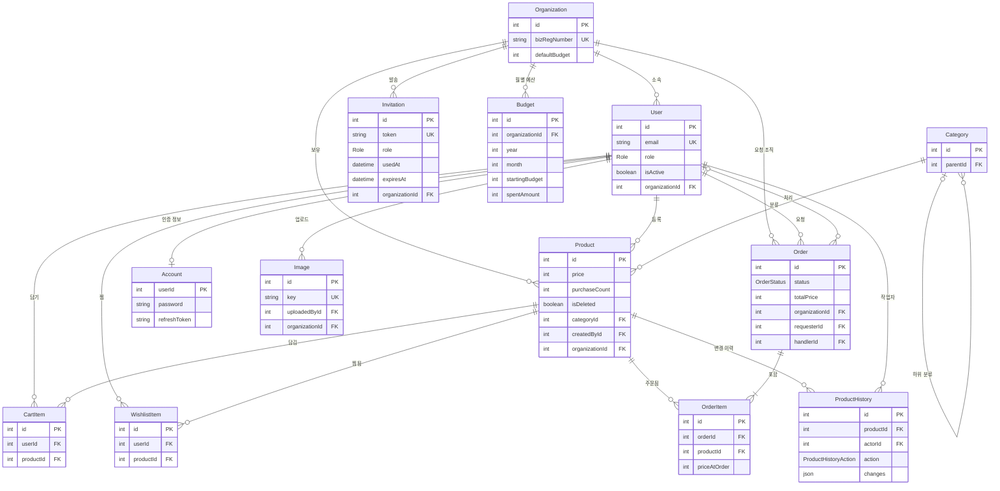
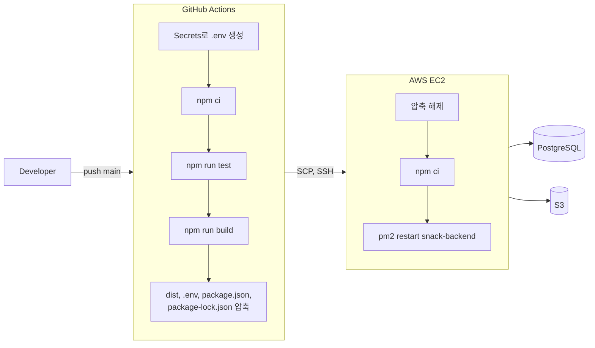

<div align="center">

# SNACK 🍪 Backend

### 사내 간식 구매부터 관리까지, 한 곳에서.

**원스톱 간식 구매 관리 서비스 SNACK**의 API 서버  
팀 프로젝트에서 **상품 도메인 백엔드**를 맡았고, 이후 개인 포크에서 기능을 고도화했습니다.

<br />

[Frontend 저장소](https://github.com/seonghwi-ha/13-2-snack-fe) · [팀 원본 저장소](https://github.com/myfunnyhome/13-2-snack-be)

</div>

---

# 📜 목차

1. [프로젝트 소개](#-프로젝트-소개)
2. [내 역할](#-내-역할)
3. [기술 스택](#️-기술-스택)
4. [주요 작업 내역](#-주요-작업-내역)
5. [성능 최적화](#-성능-최적화)
6. [트러블 슈팅](#-트러블-슈팅)
7. [팀 정보](#-팀-정보)
8. [아키텍처](#-architecture) · [인증](#-authentication--authorization) · [API](#-api-overview) · [ERD](#-erd) · [배포](#-cicd--deployment) · [실행 방법](#️-getting-started)

<br/>

# 📝 프로젝트 소개

여러 플랫폼에 흩어진 사내 간식 구매 내역을 한 곳에서 관리하는 서비스입니다.  
직원은 상품을 등록하고 구매를 요청하며, 관리자는 월 예산 안에서 승인·반려합니다.

- 🔐 인증 및 역할 기반 접근 제어 (JWT 쿠키 · Refresh Token Rotation · 비밀번호 재설정)
- 🛒 상품 · 장바구니 · 위시리스트 (S3 이미지 업로드 포함)
- 📝 구매 요청 및 승인 / 반려
- 👥 회원 및 초대 관리 (초대 메일 · 권한 변경 · 탈퇴 처리)
- 💰 예산 관리 (월 예산 자동 생성 · 승인 시 지출 반영 · 지출 요약)
- 📄 API 문서 (Swagger UI `/docs`)

| 구분        | 기간              | 내용                                                            |
| ----------- | ----------------- | --------------------------------------------------------------- |
| 팀 프로젝트 | 2026.08 ~ 2026.10 | 백엔드 팀원으로 상품 도메인 담당 (PR 10건)                      |
| 개인 포크   | 2026.10 ~         | 테스트 보강, 커서 페이지네이션, 검색, 캐시, 감사 로그 등 고도화 |

<br/>

# 🙋 내 역할

| 영역             | 담당 내용                                                                                           |
| ---------------- | --------------------------------------------------------------------------------------------------- |
| 공통 에러 처리   | 커스텀 에러 클래스 계층과 전역 에러 핸들러 설계 → 팀 10개 도메인 모듈이 같은 실패 응답 형식 사용    |
| 상품 API         | 목록·상세·등록·수정·삭제, 내 상품 목록, 조직 격리와 등록자·관리자 권한 검사                         |
| 이미지 API       | S3 프라이빗 버킷 업로드·스트리밍 조회·삭제, 업로드 제한과 에러 변환                                 |
| 시드 데이터      | 기획 기준 카테고리 id 고정, 공식 상품 이미지, 다품목 주문·장바구니 시나리오                         |
| 개인 포크 고도화 | 테스트 5개 → 118개, 커서 페이지네이션, `pg_trgm` 검색, Redis 캐시, 감사 로그, 이미지 정리·제공 방식 |

프론트엔드에서도 같은 상품 화면을 맡아, 화면에 필요한 값(`isMine`, `wishlistCount`, `hasNext`)을 API 응답에 직접 설계했습니다.

<br/>

# ⚙️ 기술 스택

### ✅ Language & Runtime


### ✅ Framework & Libraries


### ✅ Database & Cache

-4169E1?style=flat&logo=postgresql&logoColor=white>)


### ✅ Infra & Deployment


### ✅ Test & Tooling


기타: Nodemailer, node-cron, dayjs, express-rate-limit, multer-s3

<br/>

# 📋 주요 작업 내역

<details>
<summary>🍪 팀 프로젝트 (2026.08 ~ 2026.10)</summary>

- **공통 에러 처리 구조** (#5)
  - `AppError(message, statusCode, code)` 기반 `BadRequest` · `Unauthorized` · `Forbidden` · `NotFound` · `Conflict`
  - 전역 핸들러에서 `{ success: false, message, code }`로 통일, Zod는 `VALIDATION_ERROR`로 분리
  - Prisma `P2002` → 409, `P2025` → 404, 그 외 예외는 원인을 로그에만 남김

- **상품 API** (#29, #43, #53, #56)
  - 검색·카테고리 2단 필터·정렬(최신·인기·가격)·페이지네이션, `hasNext`
  - 모든 쿼리를 `organizationId`로 제한, 조직 id는 body가 아니라 토큰에서
  - 등록자 본인 또는 관리자만 수정·삭제 (없으면 404, 권한 없으면 403)
  - `satisfies Prisma.ProductDefaultArgs`로 select 정의에서 응답 타입 추론
  - 찜 개수 `_count` 집계, 등록자 본인 여부 `isMine`

- **S3 이미지 API** (#34, #41)
  - 프라이빗 버킷 + 서버 스트리밍 조회, UUID key, 5MB·1장·이미지 형식 제한
  - S3 클라이언트 지연 생성 (AWS 설정이 없어도 서버 기동)

- **시드 데이터** (#45, #47, #49)
  - 기획 기준 대분류·소분류 id 고정과 시퀀스 재시작, 상품 카탈로그 분리, 공식 이미지 연결

</details>

<details>
<summary>🚀 개인 포크 고도화 (2026.10 ~)</summary>

- **테스트 체계** — Jest 단위 테스트 5개 → 118개
  - repository·S3를 mock으로 대체해 DB 없이 서비스 규칙 검증
  - 테스트로 Zod union 오류 문구 버그 발견·수정

- **이미지 소유권과 고아 이미지 정리**
  - `Image` 테이블로 업로드 기록, 업로드한 본인·같은 조직 관리자 삭제 허용
  - 매일 04시(KST) 상품에 쓰이지 않는 이미지를 S3·DB에서 정리 (`node-cron`)

- **커서 기반 페이지네이션** — `GET /products?cursor=`
  - "정렬 값 + id" 커서, 정렬별 복합 인덱스, 기존 `page` 방식과 호환

- **상품명 검색 고도화** — `pg_trgm`
  - GIN 트라이그램 인덱스로 부분 일치 검색 가속
  - 결과가 0건이면 비슷한 상품명을 `suggestions`로 추천

- **Redis 상품 목록 캐시**
  - 첫 화면 목록 60초 캐시, 조직별 버전 키로 무효화, 장애 시 DB로 응답

- **상품 변경 이력 (감사 로그)** — `GET /products/:id/history`
  - 상품 변경과 같은 트랜잭션에서 바뀐 필드만 `before` / `after`로 기록

- **이미지 제공 방식 확장**
  - `IMAGE_DELIVERY_MODE=redirect`면 S3 presigned URL 또는 CloudFront 주소로 302

- **Prisma `P2003`(외래키 위반) → 400** `INVALID_REFERENCE`

</details>

자세한 설계 이유와 검증 과정은 [기여 정리 문서](docs/resume/contributions.md)에 있습니다.

<br/>

# 🚀 성능 최적화

<details>
<summary>1. Redis 캐시로 상품 목록 응답 단축</summary>

- 홈과 카테고리 탭에서 가장 많이 부르는 **조직 전체 첫 화면 목록**만 60초 캐시
- 패턴 삭제(`SCAN`) 대신 **조직별 버전 키**를 캐시 키에 넣고, 상품·찜·구매 승인 시 버전만 올려 무효화
- 오프라인 큐를 끄고 명령 제한 시간 300ms → Redis 장애가 API 지연으로 번지지 않음

| 측정 (로컬)             | 결과                   |
| ----------------------- | ---------------------- |
| 캐시 미스 → 적중        | 342ms → **1.5ms**      |
| Redis 강제 종료 후 요청 | 3.7ms에 DB로 정상 응답 |

</details>

<details>
<summary>2. 커서 페이지네이션과 정렬별 복합 인덱스</summary>

- 오프셋(`skip`)은 뒤 페이지일수록 앞의 행을 모두 읽고 버리며, 스크롤 중 상품이 추가되면 중복이 생김
- 마지막 상품의 "정렬 값 + id" 다음부터 읽고, `(organizationId, 정렬 컬럼, id)` 인덱스로 받침
- 검증: 동점이 많은 데이터에서 4가지 정렬 모두 82개를 끝까지 넘겨 중복·누락 없음

</details>

<details>
<summary>3. 트라이그램 인덱스로 부분 일치 검색</summary>

- 기존 `ILIKE '%키워드%'` 쿼리를 바꾸지 않고 GIN 트라이그램 인덱스를 추가
- 실행 계획으로 3글자 이상 키워드가 인덱스를 타는 것을 확인 (2글자는 트라이그램이 없어 전체 스캔)

</details>

<details>
<summary>4. 이미지 트래픽 분리</summary>

- 저장된 이미지 주소(`/api/images/<key>`)는 그대로 두고, 조회 API가 presigned URL·CloudFront로 302 리다이렉트
- 데이터 이전이나 프론트 수정 없이 이미지 전송을 EC2에서 분리할 수 있음

</details>

<br/>

# 💣 트러블 슈팅

<details>
<summary>1. [입력 검증] 가격을 비워 보내면 0원 상품이 저장되던 문제</summary>

- **문제**: 프론트 폼이 가격을 비우면 `null`을 보내는데 201로 0원 상품이 생성됨
- **원인**: `z.coerce.number()`가 `Number(null)`, `Number('')`를 0으로 바꾼 뒤 검사 → `.min(0)`도 통과
- **해결**: 숫자 변환 전에 숫자·비어 있지 않은 문자열만 통과시키는 전처리로 "값 없음"과 0을 구분
- **배운 점**: 타입 변환은 검증보다 먼저 일어나서 입력의 의미를 지울 수 있다

</details>

<details>
<summary>2. [목록 조회] 무한 스크롤에서 상품이 중복·누락되던 문제</summary>

- **문제**: 가격순·인기순에서 페이지 경계의 동점 상품이 두 번 나오거나 사라짐
- **원인**: 정렬 값이 같은 행의 순서는 PostgreSQL이 보장하지 않음
- **해결**: 모든 정렬의 마지막 키에 `id`를 추가 → 이후 커서 페이지네이션의 기반이 됨

</details>

<details>
<summary>3. [이미지] 목록을 오래 띄워두면 이미지가 깨지던 문제</summary>

- **문제**: 15분이 지나면 스크롤로 새로 불러오는 이미지가 모두 깨짐
- **원인**: 액세스 토큰이 15분인데, ``·`next/image` 요청은 앱의 토큰 재발급 로직을 거치지 않아 401
- **해결**: 조회 API만 인증을 빼고 추측할 수 없는 UUID key로 보호, 버킷은 프라이빗 유지, 경로 제한과 `nosniff` 추가

</details>

<details>
<summary>4. [이미지] 없는 이미지 요청에 404 대신 500이 나던 문제</summary>

- **원인**: IAM에 `s3:ListBucket` 권한이 없으면 S3가 존재 여부를 숨기려고 404 대신 403 AccessDenied를 줌
- **해결**: `NoSuchKey`와 403을 모두 404로 맞추되, 403은 설정 오류일 수 있어 서버 로그는 남김

</details>

<details>
<summary>5. [인프라] AWS 설정이 없으면 서버가 아예 뜨지 않던 문제</summary>

- **원인**: 모듈 최상단에서 `S3Client`를 만들어 `AWS_REGION`이 없으면 import 시점에 예외
- **해결**: 첫 요청 때 클라이언트를 만들고, 빠진 환경변수 이름을 에러로 알려줌. `MulterError`도 사유별 400으로 변환

</details>

<details>
<summary>6. [이미지] S3에 고아 이미지가 쌓이던 문제</summary>

- **원인**: 업로드가 DB에 기록되지 않아 누가 올렸는지, 아직 쓰이는지 판단할 수 없음
- **해결**: 업로드 기록 테이블, 삭제 순서 S3 → DB(실패해도 재시도로 맞춰짐), 매일 정리 스케줄러

</details>

<details>
<summary>7. [검색] 짧은 한글 상품명의 오타 검색이 결과를 못 찾던 문제</summary>

- **원인**: `pg_trgm` 기본 기준(0.6)은 짧은 한글에 너무 높음 ('새우강' ↔ '새우깡' = 0.5)
- **해결**: 실제 데이터로 유사도를 재서 절대 기준 0.25 + "최고 점수의 80% 이상" 상대 기준을 함께 적용

</details>

<details>
<summary>8. [캐시] Redis 도입 중 만난 날짜 타입·무효화 문제</summary>

- **문제**: 캐시에서 꺼낸 `createdAt`이 문자열이 되고, 찜을 눌러도 목록의 찜 수가 그대로
- **해결**: `...At` 필드의 ISO 문자열만 `Date`로 복원, 응답에 든 모든 값의 변경 지점(찜·구매 승인)에서 버전 키 증가

</details>

<br/>

# 👥 팀 정보

코드잇 풀스택 13기 2팀의 팀 프로젝트입니다. 팀 구성과 전체 작업 이력은 [팀 원본 저장소](https://github.com/myfunnyhome/13-2-snack-be)에서 볼 수 있습니다.  
이 저장소는 팀 프로젝트를 포크해 개인적으로 이어서 개발하는 저장소입니다.

<br/>

---

## 🏗 Architecture

### System Overview



### Request Lifecycle



**레이어 구성** — 도메인별로 `src/modules/<domain>/` 아래에 같은 구조를 둡니다.

| 파일              | 역할                                                              |
| ----------------- | ----------------------------------------------------------------- |
| `*.schema.ts`     | Zod로 body · query · params 검증, 입력 타입 추론                  |
| `*.controller.ts` | 요청 파싱, 서비스 호출, `{ success, data }` 응답과 쿠키 처리      |
| `*.service.ts`    | 비즈니스 규칙, `BadRequestError` · `NotFoundError` 등 커스텀 에러 |
| `*.repository.ts` | Prisma 쿼리와 트랜잭션                                            |

**역할 기반 라우터 구성** — 권한 검사를 라우터 진입 시점에 한 번에 적용합니다.

| Route 그룹       | 미들웨어                        | 대상                           |
| ---------------- | ------------------------------- | ------------------------------ |
| `/me/*`          | `authenticate`                  | 로그인한 본인 리소스           |
| `/admin/*`       | `authorize(ADMIN, SUPER_ADMIN)` | 구매 요청 승인·반려, 예산 요약 |
| `/super-admin/*` | `authorize(SUPER_ADMIN)`        | 회원 초대·관리, 예산 설정      |

상품·주문·회원·예산의 조회와 변경은 토큰의 `organizationId`로 범위를 제한해, 다른 조직의 데이터에는 접근할 수 없습니다.

### Project Structure

```text
src
├── server.ts        # 진입점: 이번 달 예산 확인 → cron 등록 → listen
├── app.ts           # 공통 미들웨어, 라우터, 404, 전역 에러 핸들러
├── config/          # Prisma Client, S3 Client, Redis Client, Swagger
├── routes/          # URL 구성 (me / admin / super-admin 그룹)
├── modules/         # auth, user, invitation, product, image,
│                    # cartItem, wishlist, order, budgets
├── middlewares/     # 인증·인가, 업로드, rate limit, errorHandler
├── schedulers/      # 월 예산 생성, 고아 이미지 정리 cron
├── docs/            # Swagger(OpenAPI) 주석
├── types/           # 커스텀 에러 클래스, Express 타입 확장
└── utils/           # JWT, 비밀번호, 토큰 해시, 메일, KST 날짜
prisma/              # schema.prisma, migrations, seed
http/                # 수동 API 요청 파일 (.http)
```

팀 코딩 컨벤션은 [BE_CONVENTION.md](BE_CONVENTION.md)에 정리되어 있습니다.

## 🔐 Authentication & Authorization

Access Token과 Refresh Token을 모두 **HttpOnly 쿠키**로 발급합니다.



- 두 토큰은 서로 다른 secret으로 서명(HS256)하고, payload의 `type`(`access` / `refresh`)까지 검사합니다.
- DB에는 Refresh Token 원문이 아닌 해시만 저장하고, 재발급할 때마다 교체합니다.
- 로그아웃, 비밀번호 재설정, 회원 탈퇴 처리 시 저장된 Refresh Token을 지워 기존 세션을 끊습니다.
- 초대·비밀번호 재설정 토큰도 DB에는 해시만 저장합니다. (초대 7일, 재설정 30분 유효)
- 로그인, 회원가입, 재설정 메일 요청에 rate limit을 적용합니다.

| 역할          | 권한                                                               |
| ------------- | ------------------------------------------------------------------ |
| `GENERAL`     | 상품 등록·조회, 장바구니, 찜, 구매 요청, 본인 상품 수정·삭제       |
| `ADMIN`       | GENERAL 권한 + 구매 요청 승인·반려, 즉시 구매, 모든 상품 수정·삭제 |
| `SUPER_ADMIN` | ADMIN 권한 + 회원 초대·권한 변경·탈퇴 처리, 예산 설정, 회사명 변경 |

최고관리자는 기업 담당자 회원가입으로만 생성되고, 초대·권한 변경으로는 `GENERAL`, `ADMIN`만 부여할 수 있습니다.

## 📡 API Overview

전체 요청·응답 명세는 Swagger UI(`/docs`)에서 확인할 수 있습니다.

| 도메인     | 엔드포인트                                                             | 설명                                       |
| ---------- | ---------------------------------------------------------------------- | ------------------------------------------ |
| Auth       | `/auth/signup` `/auth/signin` `/auth/signout` `/auth/refresh-token`    | 최고관리자·초대 가입, 로그인, 토큰 재발급  |
|            | `/auth/password-reset`                                                 | 재설정 메일 요청, 새 비밀번호 설정         |
| Invitation | `/invitations/:token`                                                  | 초대 정보 조회                             |
| Me         | `/me` `/me/profile`                                                    | 내 정보 조회, 비밀번호·회사명 변경         |
| Product    | `/products` `/products/:id` `/me/products`                             | 상품 검색·정렬·등록·수정·소프트 삭제       |
|            | `/products?cursor=` `/products/:id/history`                            | 커서 페이지네이션, 변경 이력 (관리자 이상) |
| Image      | `/images` `/images/*key`                                               | S3 업로드, 서버 경유·리다이렉트 조회, 삭제 |
| Cart       | `/me/cart-items`                                                       | 장바구니 담기·수량 변경·삭제               |
| Wishlist   | `/me/wishlist`                                                         | 찜 추가·삭제·목록                          |
| Order      | `/orders` `/me/orders`                                                 | 구매 요청, 내 요청 조회·취소               |
|            | `/admin/orders` `/admin/orders/:id/approve` `/admin/orders/:id/reject` | 조직 구매 요청 조회, 승인·반려             |
| Budget     | `/admin/budgets/summary` `/super-admin/budgets/setting`                | 지출 요약, 이번 달·기본 예산 설정          |
| Member     | `/super-admin/invitations` `/super-admin/users`                        | 회원 초대, 검색, 권한 변경, 탈퇴 처리      |

### 구매 요청과 예산 규칙

- 구매 요청은 본인 장바구니의 같은 조직 상품으로만 만들 수 있고, 생성 후 해당 장바구니 항목은 삭제됩니다.
- `GENERAL`의 요청은 `PENDING`으로 생성되고, `ADMIN` · `SUPER_ADMIN`의 요청은 예산 확인 후 바로 `APPROVED`로 생성됩니다.
- 상태 변경은 `PENDING`에서만 가능합니다: 요청자 취소(`CANCELED`), 관리자 반려(`REJECTED`), 관리자 승인(`APPROVED`).
- 승인 시 이번 달 남은 예산이 부족하면 `409 BUDGET_EXCEEDED`를 반환합니다.
- 승인은 하나의 트랜잭션에서 주문 상태 변경, 상품 `purchaseCount` 증가, 월 예산 `spentAmount` 증가를 함께 처리합니다.
- 월 예산은 매달 1일 00:00(KST) cron으로 생성하고, 서버 시작 시에도 이번 달 예산이 없는 조직에 생성합니다.

## 🗂 ERD

핵심 키와 관계 위주로 표시했습니다.



- `Role`: `GENERAL` · `ADMIN` · `SUPER_ADMIN` / `OrderStatus`: `PENDING` · `APPROVED` · `REJECTED` · `CANCELED` / `ProductHistoryAction`: `CREATE` · `UPDATE` · `DELETE`
- `Account.userId`는 `User.id`를 참조하는 PK이자 FK입니다.
- 상품·회원은 `isDeleted` · `isActive`로 소프트 삭제하고, `OrderItem.priceAtOrder`에 주문 시점 가격을 저장해 과거 주문 내역을 보존합니다.
- 복합 UNIQUE: `CartItem`·`WishlistItem`의 `(userId, productId)`, `Budget`의 `(organizationId, year, month)`

## 🚀 CI/CD & Deployment

`main` 브랜치에 push하면 [`.github/workflows/deploy.yml`](.github/workflows/deploy.yml)이 실행됩니다.



| 단계                                      | 현재 상태                                         |
| ----------------------------------------- | ------------------------------------------------- |
| 테스트 · 빌드 · EC2 전송 · PM2 재시작     | 자동 (GitHub Actions)                             |
| 환경변수                                  | GitHub Secrets(`ENV`)로 `.env`를 만들어 함께 전송 |
| PM2 프로세스 최초 등록                    | 수동 (워크플로는 `pm2 restart`만 실행)            |
| DB 마이그레이션 (`prisma migrate deploy`) | 수동 (워크플로에 포함되어 있지 않음)              |

테스트는 Jest 단위 테스트 118개(상품·이미지 서비스, 스키마, 커서, 캐시, 에러 핸들러, 토큰)이며 DB 없이 실행됩니다.

## ⚙️ Getting Started

```bash
cp .env.example .env   # 값 입력 후 진행
npm install            # postinstall에서 prisma generate 실행
npm run migrate        # prisma migrate dev
npm run seed           # 주의: 모든 테이블을 비우고 데모 데이터를 다시 넣음
npm run dev            # tsx watch, http://localhost:3000/docs
```

| 명령                        | 설명                                                        |
| --------------------------- | ----------------------------------------------------------- |
| `npm run dev`               | 개발 서버 (`tsx watch src/server.ts`)                       |
| `npm run build`             | TypeScript 빌드 (`dist/`)                                   |
| `npm start`                 | 빌드 결과 실행 (`node --enable-source-maps dist/server.js`) |
| `npm run type-check`        | 타입 검사                                                   |
| `npm test`                  | Jest 테스트                                                 |
| `npm run migrate`           | 개발 DB 마이그레이션 (`prisma migrate dev`)                 |
| `npm run seed`              | 개발용 시드 데이터                                          |
| `npm run studio`            | Prisma Studio                                               |
| `npx prisma migrate deploy` | 운영 DB 마이그레이션 (script 미등록)                        |

### Environment Variables

실제 값은 저장소에 포함하지 않습니다. 형식은 [`.env.example`](.env.example)을 참고하세요.

| 변수                                                                             | 용도                                    |
| -------------------------------------------------------------------------------- | --------------------------------------- |
| `DATABASE_URL`                                                                   | PostgreSQL 연결                         |
| `PORT`, `NODE_ENV`                                                               | 서버 포트, 운영 모드(쿠키·Swagger 경로) |
| `JWT_ACCESS_SECRET`, `JWT_REFRESH_SECRET`                                        | 토큰 서명                               |
| `JWT_ACCESS_EXPIRES_IN`, `JWT_REFRESH_EXPIRES_IN`                                | 토큰 만료 (기본 15m / 3d)               |
| `CLIENT_URL`                                                                     | CORS origin, 메일 링크 주소             |
| `AWS_REGION`, `AWS_S3_BUCKET_NAME`, `AWS_ACCESS_KEY_ID`, `AWS_SECRET_ACCESS_KEY` | S3 (키가 없으면 AWS SDK 기본 자격 증명) |
| `API_BASE`                                                                       | 응답 이미지 URL 접두사                  |
| `SWAGGER_SERVER_URL`                                                             | Swagger 서버 주소                       |
| `GMAIL_USER`, `GMAIL_APP_PASSWORD`                                               | 메일 발송                               |
| `REDIS_URL`                                                                      | 상품 목록 캐시 (선택, 없으면 캐시 끔)   |
| `IMAGE_DELIVERY_MODE`, `IMAGE_CDN_BASE_URL`                                      | 이미지 제공 방식 `proxy` / `redirect`   |
